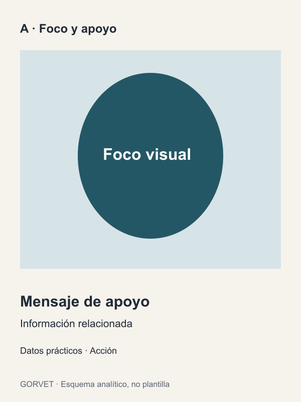
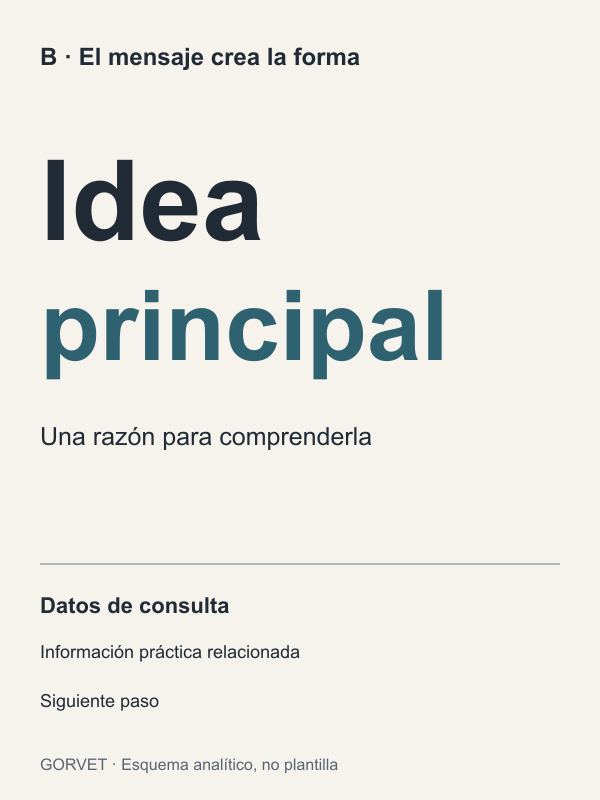
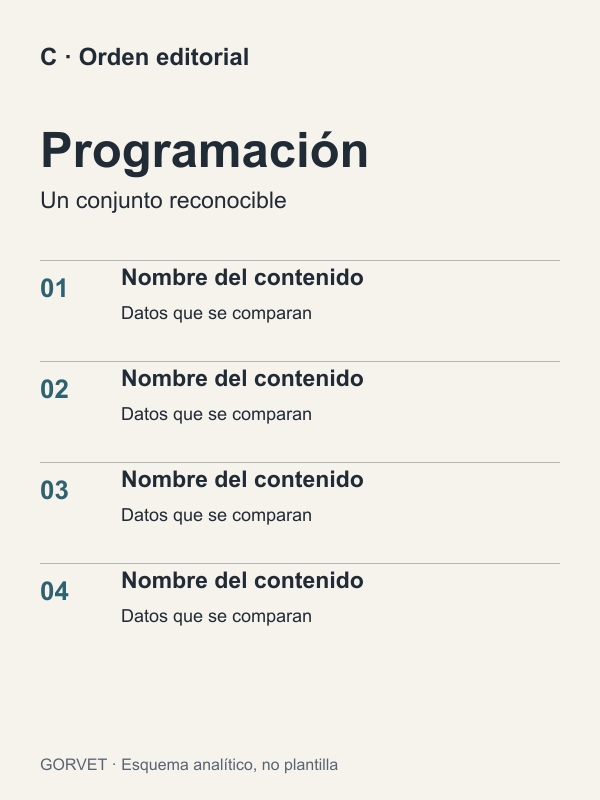
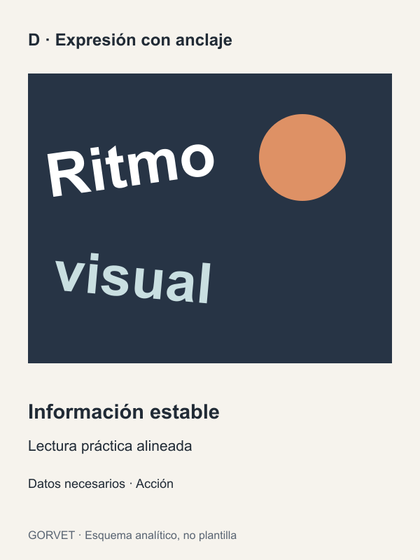

# Repertorio visual comentado

Estas fichas enseñan operaciones de diseño. Los esquemas locales son dibujos originales de Gorvet Estudios, publicados con la licencia del repositorio. Se incluyen como PNG para lectura visual y SVG editable. Son mapas de relaciones, no reproducciones de las obras citadas ni plantillas que haya que usar. Las fuentes externas permiten estudiar las obras y ampliar el repertorio cuando hay navegación; el skill funciona sin abrirlas.

## Cómo utilizar el repertorio

Elige por el problema de comunicación, no por parecido del sector. Mira foco, escala, alineación, densidad y recorrido; decide qué relación sirve a tu encargo. Adapta esa relación al copy y al soporte reales. Ninguna ficha prescribe colores, un número de bloques o una posición universal.

Si se necesita una referencia visual para una herramienta, suministra una imagen que pueda usar y explica su papel. Un enlace o una ficha Markdown no equivale a adjuntar una imagen. No copies automáticamente palabras, marcas o adornos de una referencia.

## A. Un foco y una lectura secundaria

**Mecanismo:** la masa principal capta atención; la información de apoyo ocupa otra zona con alineación estable y menor peso. El vacío diferencia funciones sin dibujar un marco para cada dato.

**Aplicación:** cuando un sujeto visual o una idea reconocible sostiene el argumento. La imagen puede cambiar de posición o dejar paso a tipografía protagonista.

**Límite:** una imagen dominante no puede borrar una condición necesaria. Los datos siguen siendo legibles; no se esconden como letra decorativa.

**Estudio externo:** [Musica Viva, 1958 — Josef Müller-Brockmann, MoMA](https://www.moma.org/collection/works/7233). Estudia la relación entre una forma gráfica protagonista y el programa tipográfico. [Descubrimiento en Pinterest](https://ru.pinterest.com/pin/1062708843336590290/); verifica la obra en la ficha del museo, no atribuyas autoría al usuario que publica el pin.

## B. El mensaje crea la forma

**Mecanismo:** la diferencia de escala y peso convierte palabras seleccionadas en forma visual. El resto conserva una estructura de consulta. El énfasis responde al significado y no se reparte por igual entre todas las palabras.

**Aplicación:** mensajes que pueden sostener la pieza sin depender de una fotografía. La caja, los saltos y la anchura construyen voz y ritmo.

**Límite:** la tipografía expresiva puede dominar el título, pero no exige volver expresivos dirección, horario y contacto. No adoptar mayúsculas o inclinaciones por imitación.

**Estudio externo:** [The Public Theater — Pentagram / Paula Scher](https://www.pentagram.com/work/the-public-theater). El estudio documenta cómo la voz gráfica responde a la institución y evoluciona entre campañas. [Selección en Pinterest](https://www.pinterest.com/pin/305048574754014366/). Extrae el vínculo entre intención y tipografía; no conviertas esa voz teatral en estilo predeterminado para cualquier anuncio.

## C. Orden para contenido denso

**Mecanismo:** un encabezado identifica el conjunto; columnas o filas repetidas permiten comparar datos del mismo tipo. Espacios y alineaciones expresan pertenencia. El contenido de igual nivel comparte tratamiento, mientras el conjunto mantiene un foco reconocible.

**Aplicación:** programación, invitaciones con información abundante o piezas de consulta. Usa la estructura que exige el contenido, no una retícula prefijada.

**Límite:** no transformar una oferta simple en una tabla ni añadir celdas vacías para rellenar el formato. La densidad puede ser necesaria; la competencia de todos los niveles no lo es.

**Estudio externo:** [The Public Theater, temporada 1995–96 — Paula Scher, MoMA](https://www.moma.org/collection/works/8840). Compara una comunicación de temporada con una comunicación de un solo acontecimiento: la información real cambia la estructura. Este esquema enseña una solución editorial propia, no reproduce ese cartel.

## D. Expresión con anclaje

**Mecanismo:** el contraste o movimiento se concentra en el argumento visual. Un área estable permite consultar los datos y evita que toda la pieza tenga el mismo ruido.

**Aplicación:** una intención expresiva justificada por público y campaña. Puede emplear collage, rotación o textura como lenguaje coherente.

**Límite:** no sumar efectos para «dar impacto». La expresión tiene que ayudar a reconocer la idea y conservar la lectura.

**Estudio externo:** [How Posters Work — Cooper Hewitt, Smithsonian Design Museum](https://www.cooperhewitt.org/exhibitions/how-posters-work/). La exposición estudia comunicación visual mediante percepción y relato; sirve para comparar estrategias distintas, no para buscar una única receta de buen cartel.

## Ampliar las referencias

Pinterest sirve para descubrir trabajos y reunir enlaces; busca la fuente del diseñador, estudio o museo para comprobar título y autoría. Mantén una selección variada de mecanismos, no veinte ejemplos del mismo acabado. En una ficha nueva registra fuente, autor conocido, mecanismo, aplicación y límite. Si no has podido observar una imagen, no inventes su análisis.

Este paquete enlaza las obras externas; no incorpora sus imágenes ni les aplica la licencia MIT del repositorio. Para referencias aportadas por el usuario, distingue material para analizar de material autorizado para redistribuir.

## Casos completos: del criterio al encargo

Estos casos son ficticios y muestran decisiones transferidas a instrucciones. No son resultados generados ni pruebas de rendimiento. Lee el que ayude al problema actual; no copies la distribución de un caso a otro encargo. El copy de cada ejemplo aparece únicamente en su lista de textos visibles.

### Producto: mostrar un atributo físico

**Brief supuesto:** catálogo vertical de tazas Nara; el usuario confirma que son de cerámica hecha a mano, color azul mate. Sin foto de producto ni precio. La pieza identifica la línea; la descripción de la publicación contiene el catálogo completo.

**Decisión:** la forma y el acabado sostienen el argumento. Una vista cercana y una luz que revela la superficie bastan; no hacen falta pedestal, salpicaduras ni afirmaciones de resistencia. Sin foto, no puede prometerse una geometría exacta del modelo real.

**Encargo resuelto:**

> Cartel vertical 4:5 para una línea de tazas de cerámica. Fondo continuo amarillo ocre y superficie del mismo tono. Una taza azul mate vista a tres cuartos ocupa la mitad inferior, con el asa reconocible a la derecha y apoyo sobre la superficie. Luz amplia desde arriba a la izquierda, variación suave que revela el volumen y la textura, sombra de contacto coherente. La zona superior queda libre para el mensaje. Composición sobre un eje izquierdo compartido por los dos textos; el ancho de la taza equilibra el bloque tipográfico. Tipografía serif de trazos firmes en azul oscuro, contrastada con el fondo. Textos visibles, sin añadir otros:
>
> - «Tazas Nara»: titular de mayor masa tipográfica en la zona superior izquierda, con espacio respecto al borde y a la imagen.
> - «Cerámica hecha a mano»: apoyo inmediatamente debajo, de menor tamaño y peso regular.

**Qué comprobar:** entrada por titular y objeto como conjunto, reconocimiento del acabado mate, apoyo físico y ausencia de beneficios inventados. Si el usuario requiere mostrar un modelo comercial exacto, este brief necesita su foto o especificaciones antes de acreditar fidelidad de producto.

### Persona: el tema introduce y el retrato identifica

**Brief supuesto:** cartel de un taller de fotografía para principiantes. El usuario aporta un retrato utilizable de la ponente, autoriza un recorte y pide conservar su identidad y ropa. Tipo de actividad, tema, nombre, fecha y sede son los únicos textos; el cartel circulará solo y no requiere datos de inscripción.

**Decisión:** la luz de ventana conecta visualmente con el tema. El titular introduce el taller; el retrato identifica a quien lo imparte; los datos de asistencia tienen un grupo propio. No atribuir credenciales ni inventar un equipo profesional.

**Encargo resuelto, adjuntando efectivamente el retrato:**

> Cartel vertical 4:5 de un taller de fotografía. Usa la imagen adjunta como referencia de identidad y vestuario de la ponente. Conserva rostro, tono de piel, edad aparente, proporciones y ropa; permite recorte de medio cuerpo y adaptación de luz. Retrato en la zona derecha, de medio cuerpo, con mirada a cámara y expresión relajada; luz amplia de ventana desde la izquierda, textura de piel visible. Fondo gris cálido claro, con una variación lateral suave de luz vinculada al tema. La mitad izquierda queda tranquila para el bloque de texto y el rostro no lo invade. El titular aporta la mayor masa tipográfica; retrato y título forman la unidad principal. Los datos se alinean con el borde izquierdo del título en un grupo inferior, separados de este por espacio. Usa sans serif de ancho normal y color carbón; no añadas objetos o sellos. Textos visibles:
>
> - «Taller de fotografía»: rótulo de actividad encima del titular, mismo eje izquierdo, tamaño menor y peso regular.
> - «Luz de ventana»: titular en la parte superior izquierda, dos líneas divididas después de «Luz», peso fuerte.
> - «Ana Ríos»: junto al retrato, debajo del rostro, menor que el titular y mayor que los datos prácticos.
> - «18 de noviembre · 10:00»: primera línea del grupo inferior, peso medio, legible a tamaño de móvil.
> - «Estudio Norte»: debajo de la fecha, mismo eje y tamaño, peso regular.

**Qué comprobar:** el rostro no desplaza el tema ni invade el texto; se reconoce a la ponente; fecha y sede se localizan juntas. Si el generador convierte el retrato en fondo completo y encoge el titular abajo, no está ejecutando la distribución indicada.

### Persona con producto: la interacción explica

**Brief supuesto:** una marca promociona una botella reutilizable mediante una escena de uso. El usuario aporta una foto de la botella cerrada con tapa de rosca, confirma esa función y no solicita una identidad humana concreta. No se anuncian capacidades térmicas ni resistencia.

**Decisión:** mostrar el momento de abrirla comunica un uso sencillo sin inventar prestaciones. La interacción añade requisitos de escala y agarre a la fidelidad del producto.

**Encargo resuelto, adjuntando efectivamente la foto del producto:**

> Cartel vertical 4:5 de una botella reutilizable. La imagen adjunta gobierna silueta, proporciones, color, acabado y detalles visibles del producto. Una persona ficticia adulta aparece sentada ante una mesa, encuadrada del pecho a las manos en la mitad inferior izquierda. La botella se apoya en la mesa: la mano izquierda estabiliza el cuerpo por el lateral y la derecha inicia el giro de la tapa todavía colocada, sin ocultar la cara principal del envase. Conserva escala funcional entre botella y manos, contacto y oclusión creíbles. Luz difusa lateral compartida por piel, botella y mesa, textura de piel visible y acabado del producto según la referencia. Fondo verde profundo, con zona superior derecha libre. Conserva el color original del producto y un contraste que permita distinguir su silueta. El gesto y el producto forman el foco fotográfico; el mensaje ocupa el área libre y la marca queda subordinada sobre el mismo eje. Textos visibles:
>
> - «Tu pausa, contigo»: titular en la parte superior derecha, dos líneas divididas tras la coma, sans serif de peso fuerte y color blanco roto.
> - «Nara»: marca debajo del titular, tamaño menor y peso medio.

**Qué comprobar:** el gesto es realizable, no se deforma el producto para mostrarlo y la escena no incorpora beneficios no confirmados. Si la fotografía no permite reconocer la tapa o el modelo, la fidelidad necesita mejor evidencia; no se resuelve inventándolo.

### Contenido denso: jerarquía sin fotografía obligatoria

**Brief supuesto:** cartel autónomo de dos talleres consecutivos en una misma sede; el usuario exige conservar actividad y horario de ambos. No hay fotos ni es necesario añadirlas.

**Decisión:** el título identifica el conjunto; dos filas de estructura común permiten consultar el programa. Se conserva toda la información sin asignar un icono o tarjeta a cada dato.

**Encargo resuelto:**

> Cartel vertical 4:5, composición tipográfica sobre fondo blanco con texto negro y acento rojo reservado a las horas. Encabezado en el tercio superior; programa debajo en dos filas abiertas que comparten estructura: hora en una columna estrecha a la izquierda y actividad en una columna más ancha a su derecha. Las actividades tienen mayor tamaño que las horas, pero menor masa que el título. El rojo permite localizar los horarios sin darles tamaño de titular. El espacio entre filas distingue sesiones sin cajas; no separar cada palabra del nombre de una actividad. La sede cierra abajo alineada con el título y separada del programa. Una sola familia sans serif, peso fuerte para título, medio para actividades y regular para horarios y sede. Textos visibles:
>
> - «Sábado de fotografía»: encabezado, dos líneas divididas después de «Sábado».
> - «10:00»: columna de hora de la primera fila.
> - «Luz de ventana»: actividad de la primera fila.
> - «16:00»: columna de hora de la segunda fila.
> - «Retrato en estudio»: actividad de la segunda fila.
> - «Estudio Norte · 18 de noviembre»: pie de sede y fecha, legible y de menor tamaño que las actividades.

**Qué comprobar:** se identifica el conjunto antes de consultar el programa; cada hora se asocia inequívocamente a su actividad; sede y fecha no se pierden. Una pieza sin fotografía también necesita argumento, proporción y ritmo.
